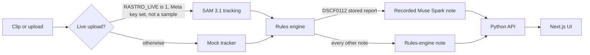

# Rastro

A field notebook for a camera clip: a zone, a count the rules engine owns, and a note a person confirms.

[](LICENSE)
[](pyproject.toml)
[](web/package.json)
[](#testing)
[](.github/workflows/ci.yml)

| | |
| --- | --- |
| Demo video | coming soon |
| Repository | [derling-torres-campos/rastro](https://cursor.com/codebase/derling-torres-campos/rastro) |
| Decisions | [`docs/DECISIONS.md`](docs/DECISIONS.md) |
| Result schema | [`docs/OUTPUT_SCHEMA.md`](docs/OUTPUT_SCHEMA.md) |
| Design | [`docs/design/DESIGN.md`](docs/design/DESIGN.md) |
| Architecture notes | [`docs/design/arquitectura.md`](docs/design/arquitectura.md) |
| Wireframes | [`docs/design/wireframes.md`](docs/design/wireframes.md) |
| Crowd pack notes | [`docs/design/pack_multitudes.md`](docs/design/pack_multitudes.md) |
| Hackathon disclosure | [`HACKATHON.md`](HACKATHON.md) |

[`HACKATHON.md`](HACKATHON.md) records commit `2ea5568` ('Add Rastro source as the project home') and states that everything shown was built during the event.

## The problem

A camera writes a box on every frame. Those boxes are not a census. A tracker id that appears, leaves, and comes back can look like a new animal. A person-shaped box is not a name. A vehicle total without a labeled survey is not a traffic count. People per square metre without a measured area is not a density.

Someone still has to see the clip, read one number, and decide what to do with the alert. Rastro keeps that decision in the app.

## What Rastro adds

Four pieces, each wired in this repository.

**1. Farm and wildlife cameras, with zones and sustained alerts.**
A zone is a polygon. The point that is tested is the bottom center of the box, the feet. An alert opens only after that side has held for `sustain_s` (3 seconds on the farm pack, and on Organ Mountains, Goat lane, and Forest trail) and for more than one frame. One frame on the other side does not flip a side that already held, and it does not fire alone. Goat lane says "Animal left the safe zone". A wild animal inside the pen says "Wild animal entered the pen and stayed {n} s". Confirm and dismiss stay in the app (`notify` is `in_app`). Organ Mountains is a bait station with a gray fox, not a livestock pen. PASS on those cameras means a local detector matched a hand label in `eval/alert_set/`. It is not a new SAM call.

**2. A protected-area review that never notifies authorities.**
Forest trail raises one alert: "Possible person inside the protected area — review needed". The only action is Review. Confirm is rejected (`this note does not use that action`). The alert stores `authorities: false`, the person box is marked blurred, and identity fields (`name`, `face_id`, `track_id`, and the rest of `IDENTITY_KEYS` in `worker/rastro/zones.py`) are not kept. The pack sets `identity` and `notify_authorities` to false. The field note says "Person box. No identity." Severity on that note is `not sure`.

**3. Peak-hour and density charts.**
Crowd and traffic runs can be summed by hour and weekday. Until the process has stored 7 real runs (`is_mock` is false) for that pack, the chart badge is **Example data**. After that it is **Your data**. Traffic stays `not_verified` either way. Only the aggregate row is kept (station, hour, weekday, count). The crowd UI prints `(NOT VERIFIED: area not calibrated)` next to a density. The crush-risk rule is 6 people/m², and it runs only when a zone has `area_m2`. The plaza camera has no area, so that alert is not raised and the note says "No people/m² on this clip."

**4. A traffic file in a CIFS shape. Not a partnership.**
`GET /api/open/events` returns JSON whose incidents use the public Closure and Incident Feed fields (`id`, `type`, `street`, `polyline`, `direction`, `starttime`, `description`). The file is in a standard format compatible with Waze for Cities. It is not a partnership. `GET /api/open/events.xml` is the same content in XML. `GET /api/open/peak-hours` is a read-only list of peak hours. `GET /api/open/waze-link` returns `https://www.waze.com/ul?ll=...` and only opens a map. The feed sets `partnership` to false, `not_verified` to true, and `submit_to_waze` to false. The street is "Example road" and the point is an example in San José (9.928069, -84.090725). The server does not send the file anywhere.

## Where you'd use it

Each case below is a path this repository already runs.

- **A pen.** Goat lane watches a yard. The animal has to stay outside the polygon, then the app asks you to confirm or dismiss. Nothing is texted.
- **A bait station.** Organ Mountains replays a night trail clip. The fox stays in the bait polygon. The verification note is a hand label plus a local infrared detector.
- **A trail in a protected area.** Forest trail asks for Review. The note does not name the person and does not notify authorities.
- **A stored camera-trap run.** Trap line replays DSCF0112: 90 raw detections of a coyote (individuals NOT VERIFIED), with the Muse Spark paragraph already saved in that run. Opening it does not call SAM or Baseten.
- **A week of counts.** The cameras page charts hour and weekday. With fewer than 7 real runs the chart is Example data. Traffic keeps the not-verified mark.
- **A file a mobility program could read later.** The open endpoints above build a CIFS-shaped example. Joining Waze for Cities is still required before any ingestion. This server does not submit the file.

## Try it

Mock is the default. The API stays on the mock tracker unless `RASTRO_LIVE` is exactly `1` and a Meta or Baseten key is set. Without that flag, a run stays on the mock tracker even if `META_API_KEY` or `BASETEN_API_KEY` is set. Sample clips stay on the mock tracker when the flag is set.

With Docker, the app is published on [http://127.0.0.1:43123](http://127.0.0.1:43123) and the worker on `127.0.0.1:8787`. Inside Compose the app calls `http://api:8787`.

```bash
curl -s http://127.0.0.1:8787/health
curl -s http://127.0.0.1:8787/api/open/peak-hours
curl -s http://127.0.0.1:8787/api/open/events
```

`/health` reports `mock_mode`. The open routes answer without a write token.

## Quick start

Docker Compose refuses to start until `RASTRO_WRITE_TOKEN` is set. The message in `docker-compose.yml` is `Set RASTRO_WRITE_TOKEN in .env`. Put the same value on the web service and the API. The browser never receives it. `.env.example` lists the names and leaves the values empty.

```bash
cp .env.example .env
docker compose up --build
```

Without Docker, two processes:

```bash
python3 -m venv .venv && source .venv/bin/activate
pip install -r requirements.txt
PYTHONPATH=worker RASTRO_STAGE_SLEEP=0 python -m rastro.api
```

```bash
cd web && npm install && RASTRO_API_URL=http://127.0.0.1:8787 npm run dev
```

`python -m rastro.api` runs `worker/rastro/api.py` (`worker/rastro/__main__.py` is `python -m rastro`, which starts the same server). `npm run dev` is Next.js (`web/package.json`), on Next's default port. Point `RASTRO_API_URL` at the worker.

Leave `RASTRO_LIVE` unset for mock. A live upload needs `RASTRO_LIVE=1`. With that flag, an upload uses SAM when `META_API_KEY` or `MODEL_API_KEY` is set, and Muse Spark when `BASETEN_API_KEY` is set. Do not commit those values.

In the app, pick a sector and run a sample, or drop an MP4 or MOV (optional voice note). Uploads are MP4 or MOV, at most 50 MB and 120 seconds. A live voice note must be WAV.

## How it works



`worker/rastro/pipeline.py` runs pack, then SAM or the mock client, then `count_unique`, then alerts, zones, and density. The API (`python -m rastro.api`) stores the job and the Next.js app reads it.

A live upload with `RASTRO_LIVE=1`, a Meta key, and `BASETEN_API_KEY` can also ask Muse Spark to write the pipeline report (`use_spark` in `worker/rastro/api.py`). If that call fails, the report source is `local-fallback`. Opening a field note does not call SAM or Baseten (`paid_call` is false).

The field note labeled as a recorded Muse Spark summary is only DSCF0112 (`_source` is `baseten-spark` and the source video is DSCF0112, model `meta-models/muse-spark-open-1026`). Every other note is `local-rules` and the card says Muse Spark was not called. Checked-in report files for DSCF0104 (`web/public/runs/demo-real-coyote`) and `web/mock/fauna-demo` also contain `_source: baseten-spark`. The note builder does not replay those as the recorded summary.

`supabase/` is a schema. This Compose file does not start a database. `worker/queue_worker.py` drains a queue when `SUPABASE_URL` and `SUPABASE_SERVICE_ROLE_KEY` are set. The local demo uses the API.

## Design decisions worth reading

**The DSCF0112 line is 90 raw detections, and the unique figure is not a verified census.**
`web/public/runs/demo-real-coyote-0112/result.json` stores `detections_total` 90, `naive_count` 2, `unique_count` 2, and `is_mock` false. Two tracks (`coyote-1`, `coyote-2`) hold 45 detections each. `tracking_line` in `worker/rastro/agent.py` can format that as "90 raw detections → 2 unique coyotes". `note_dscf0112` replaces the public line with "90 raw detections of a coyote (individuals NOT VERIFIED)" and says unique individuals are not verified. The page replays the file. It does not call SAM again. 90 is `detections_total`, not `naive_count`.

**The write token is checked on the server, from the socket.**
`writes_allowed` compares `X-Rastro-Token` with `RASTRO_WRITE_TOKEN` using `secrets.compare_digest`. When the variable is unset, only `127.0.0.1` and `::1` may write, read from `client_address`, not from a forwarded header. The Next route `web/src/app/api/field-note/route.ts` attaches the token on the server. A mismatch returns `write token required` (401). Compose will not boot without the variable (`Set RASTRO_WRITE_TOKEN in .env`).

**Mock is the default.**
`mock_mode` is true unless `RASTRO_LIVE` is exactly `1` and a Meta or Baseten key is set. Sample clips stay on the mock tracker. An upload without the flag, or without a Meta key, is stored as an uncomputed result rather than a fake count.

**Traffic and density stay labeled.**
Traffic notes say "No verified vehicle count" and severity `not sure`. Density text includes `(NOT VERIFIED: area not calibrated)`. Peak charts stay on Example data until 7 real runs, and traffic stays not verified after that switch.

**A noisy frame does not open a zone alert.**
The feet have to hold. Farm and protected cameras use that rule. Forest trail exposes Review and rejects Confirm. `authorities` stays false.

**Webhooks and stream URLs are recorded, not opened.**
`POST /api/webhooks` stores an `http` or `https` URL in memory (50 entries) and returns `delivery: off`. Confirming or reviewing a note queues a payload and does not POST it. `POST /api/streams` accepts `rtsp`, `rtsps`, HLS (`.m3u8`), or MJPEG, responds with `connected: false` and `mode: simulated`, and does not open the URL.

## When something goes wrong

| Symptom | Cause | Fix |
| --- | --- | --- |
| Compose prints `Set RASTRO_WRITE_TOKEN in .env` | `docker-compose.yml` requires the variable on `api` and `web` | Set the same value in `.env` for both services. Leave it out of git. |
| The card says `Could not save: write token required` | The API saw a non-loopback client, and the token was missing or did not match | On the host, leave the token unset so loopback writes work, or set the same token on Next and the API. The browser does not send it. |
| `Could not save: server error (0)` | The browser could not reach `/api/field-note` | Start the API and `npm run dev`, with `RASTRO_API_URL` pointing at the API. |
| `Could not save: this note does not use that action` | Confirm was sent to Forest trail | That note accepts Review only. |
| `Could not save: unknown note` | The id is not a known clip, camera, or finished run | Use the id the note returned. |
| `Only .mp4 or .mov files are accepted.` or `file exceeds 50 MB` or `Video is longer than 120 seconds.` | Upload checks in `worker/rastro/api.py` | Send an MP4 or MOV inside those limits. |
| `Live voice notes must be WAV.` | `RASTRO_LIVE=1` rejects other audio | Send WAV, or stay in mock. |
| `ffprobe is not installed; cannot check duration.` | The duration check shells out to ffprobe | Install ffprobe, then upload again. |
| The engine proxy returns `Can't reach the analysis server, try again` | Next could not fetch `RASTRO_API_URL` | Start `python -m rastro.api` and match the URL. |
| A job's `error` is `interrupted` | The API restarted while the job was queued or processing | Run the job again. Finished results stay on disk under `RASTRO_JOBS_DIR`. |
| Keys are set and the run is still mock | `RASTRO_LIVE` is missing or not exactly `1` | Set `RASTRO_LIVE=1`. Samples still use the mock tracker. |
| `webhook host is not allowed` or `webhook url must not include a secret` | The URL is local, private, or contains a user or password | Use a public `http` or `https` URL. Delivery stays off. |
| `url is not rtsp, hls, or mjpeg` | `POST /api/streams` did not recognize the address | The recognized forms stay simulated. The stream is not opened. |

## Testing

`pytest -q tests eval/tests` reported **126 passed** when this README was written. No network and no API keys. `.github/workflows/ci.yml` runs that same command on push and pull request (Python 3.12).

```bash
pytest -q tests eval/tests
cd web && npx tsc --noEmit
cd web && npm run lint
cd web && npm run build
python eval/score.py --alerts
```

`npx tsc --noEmit`, `npm run lint`, and `npm run build` are the TypeScript check, `next lint`, and `next build` in `web/`. `tsc` is not an npm script; `web/tsconfig.json` is what `tsc` reads.

`eval/score.py` scores clips under `outputs/real` by default (that directory is not in git; a missing directory yields no payload). `--alerts` then compares `eval/alert_set/` with the recorded cameras. PASS there means the local detector matched a hand label. Spend recorded on that manifest is 0. The script does not call Meta or Baseten.

## What it does not do

- It does not identify a person or re-identify people. Crowd results set `reidentifies` to false. Person alerts drop identity keys and blur the box. The fauna tracker can stitch an animal that left and came back. That stitch is not a person id.
- It does not notify authorities. Forest trail stores `authorities: false`. Alerts use `notify: in_app`. Webhook delivery stays off.
- It does not produce a verified vehicle count. Traffic text says "No verified vehicle count".
- It does not calibrate density. The mark is `(NOT VERIFIED: area not calibrated)`. Without `area_m2`, people/m² is not computed.
- It labels Example data where the series is still the built-in sample (peak charts under 7 real runs, the CIFS file, mock runs).
- It does not deploy. Compose binds the app and the API to `127.0.0.1`. There is no hosted release in this repository.
- It does not send the CIFS file to Waze, and it does not claim a partnership.
- It does not open RTSP, HLS, or MJPEG URLs. Those routes classify the address and stay on a simulated clip.
- It does not treat the DSCF0112 `unique_count` of 2 as a verified count of coyotes. The public line is "90 raw detections of a coyote (individuals NOT VERIFIED)".
- It does not call Muse Spark for the notes other than DSCF0112. Those notes come from the rules engine. Page load does not call SAM or Baseten.

## Roadmap

These items are already written in the repo as unfinished work, not as results.

| Where it is written | What is still open |
| --- | --- |
| `PENDIENTES-DERLING.md`, `eval/GAPS.md` | A crowd clip recorded in San José, plus an approximate area in square metres. Without that area, people/m² on a real plaza clip stays unverified. |
| `PENDIENTES-DERLING.md`, `eval/GAPS.md` | An optional San José intersection for traffic. The current traffic numbers stay NOT VERIFIED. |
| `PENDIENTES-DERLING.md` | A public demo is undecided. The note there says video plus this repo remains the choice while nothing else is selected. A keyed deploy is described as not recommended. This repository does not deploy. |
| `docs/pitch/demo_script.md`, `PENDIENTES-DERLING.md` | The pitch video is not recorded. The demo-video cell above stays "coming soon" until a URL exists in the repo. |
| `docs/DECISIONS.md`, `worker/rastro/feeds.py` | Real Waze ingestion requires joining Waze for Cities. The example file is not for upload. |
| `docs/DECISIONS.md`, `HACKATHON.md` | Webhook URLs can be stored. Delivery is off until a real POST is built. |
| `docs/DECISIONS.md`, `worker/rastro/streams.py` | A licensed public camera URL is not wired. RTSP, HLS, and MJPEG stay simulated. |
| `docs/DECISIONS.md` | Weather and a map (Open-Meteo, Nominatim) were not added. The decision note says they would be context, not a new count. |
| `eval/GAPS.md`, `DATA.md` | More hand-labeled clips. DSCF0840 is NOT VERIFIED. A Costa Rica coati clip is not in the set; `packs/fauna.json` still prompts for coyote. |

## License

MIT. Copyright (c) 2026 Derling Torres Campos. See [LICENSE](LICENSE).

Clip licenses and download notes are in [`DATA.md`](DATA.md) and [`eval/LICENSES.md`](eval/LICENSES.md). Heavy videos are not stored in git.
