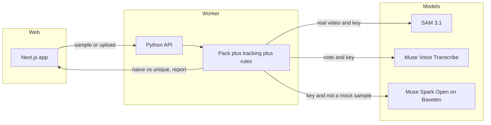

# Rastro

Rastro is a field notebook for cameras, not a one-off image analyzer. A module (camera trap, farm, crowd, or traffic) decides what matters. SAM 3.1 tracks objects through the video, the rules engine stitches a re-entry into the same individual, and Muse Spark writes one field note without changing those numbers. A person confirms or dismisses the note in the app. The proof is the stored DSCF0112 run: **90 raw detections → 2 unique coyotes**.

A sector is defined by a JSON pack.

Meta Global AI Developer Hackathon 2026 · Indie track. Submission deadline **4 Nov 2026, 8:00 p.m. Costa Rica**.

The code in this repository was written during the event (from 26 Oct 2026). License: MIT. Copyright 2026 Derling Torres Campos. See `LICENSE`.

## Run it

Docker is the path that serves the app and the worker together. The server stays in **mock** mode unless `RASTRO_LIVE=1`. Without that flag, a run stays on the mock tracker even if `META_API_KEY` or `BASETEN_API_KEY` is set. Sample clips never call a paid API. With `RASTRO_LIVE=1`, an uploaded video uses SAM when `META_API_KEY` is set, and Muse Spark when `BASETEN_API_KEY` is set.

```bash
docker compose up --build
```

Open [http://127.0.0.1:43123](http://127.0.0.1:43123). Inside Compose the app calls the worker at `http://api:8787`. On the host, that port is published only on `127.0.0.1:8787`.

```bash
cp .env.example .env   # names only; leave values blank for mock
```

In the app: pick a sector, run a sample (or drop an MP4/MOV plus an optional voice note), watch the stages, then read the count. **Camera trap** is the sample where a coyote leaves and returns under a new tracker id. The result says how many sightings were stitched into how many individuals, and the timeline shows the merged bars. Mock runs are labeled **Mock**.

### Without Docker

```bash
python3 -m venv .venv && source .venv/bin/activate
pip install -r requirements.txt
PYTHONPATH=worker RASTRO_STAGE_SLEEP=0 python -m rastro.api

# another shell
cd web && npm install && RASTRO_API_URL=http://127.0.0.1:8787 npm run dev
```

Tests (no network, no keys):

```bash
pytest -q tests eval/tests
```

## What the count means

Naive counting treats every tracker id as a new individual, including an animal that left the frame and came back. Rastro groups detections into sightings, then **stitches a re-entry** when the gap, the edge, and the overlap say it is the same body (`worker/rastro/tracking.py`). The number on screen is that result. It is not typed in by hand.

On the mock camera-trap sample the engine’s own contract (covered by `tests/test_tracking.py` and `tests/test_api.py`) is: the coyote script produces **more sightings than individuals**, and at least one track holds two tracker ids. A person in the same pack is a separate individual. The UI prints those counts, for example “5 sightings, 4 unique individuals”, only after the job finishes.

A separate **stored** clip, DSCF0112, is a previous SAM 3.1 run checked into `web/public/runs/demo-real-coyote-0112`: **90 raw detections, naive_count 2, unique_count 2, is_mock false**. The app replays that file. It does not call SAM again. 90 is `detections_total`, not the naive count.

## Sectors

A sector is defined by a JSON pack.

| Sector | File | What the result shows |
|---|---|---|
| Fauna | `packs/fauna.json` | Unique animals, re-entry stitch, alerts |
| Transit | `packs/transito.json` | Vehicles and a turn matrix. **Not a verified traffic count.** |
| Crowd | `packs/multitudes.json` | People per zone and density. **No re-identification.** One alert: 6 people/m² (high / crush risk). |
| Farm | `packs/farm.json` | A pen the owner draws. Wild animal inside, or farm animal outside, only after it stays that way for 3 seconds. In-app confirm or dismiss. The camera replays are a local detector against a hand label, not a new SAM survey. |

## Cameras

A camera in this app is not a live stream. It is a clip counted once, cached, and played back on a loop. Alerts are tied to `t_s`. Every camera is labeled **Simulated camera**.

Open [http://127.0.0.1:43123/cameras](http://127.0.0.1:43123/cameras). **Organ Mountains** is a camera trap (a gray fox at a bait station, not a livestock pen). **Goat lane** is the farm example: a zone, a 3 second wait, then Confirm or Dismiss. **Forest trail** is a protected area: the alert is “Person detected in protected zone at HH:MM”, the person box is blurred, and nothing identifies the person. The ranger presses **Review**. Rastro does not notify authorities. The label is **Possible intrusion — needs review**. **Trap line** replays DSCF0112 (90 → 2). **Wicker Park** stays **NOT VERIFIED**. The inbox stays in the app: no SMS and no push. PASS on a camera means a local detector matched a hand label (`eval/alert_set/`). It is not a new paid SAM call.

## Peak hours

Crowd and traffic counts can be added up by hour and weekday. The chart on the Cameras page is one component for both. Until the server has seen 7 real runs, the chart is labeled **Example data**. After that it switches to **Your data**. Traffic keeps the **Not verified** badge. Only the aggregate row is stored (station, hour, weekday, count) — see `supabase/peak_aggregates.sql`. That table is meant for the Supabase free tier (500 MB). Video stays out of it.

## Open peak-hour feed

`GET /api/open/peak-hours` (through the app: `/engine/api/open/peak-hours`) is a read-only JSON list of peak hours per camera. Exports in a standard format compatible with Waze for Cities live at `GET /api/open/events` (JSON) and `GET /api/open/events.xml`. This is not a partnership. The server does not send the file to Waze. Real ingestion requires joining Waze for Cities. The incidents use an example coordinate in San José and are labeled **Example data** and **NOT VERIFIED**. A deep link (`GET /api/open/waze-link`, `https://www.waze.com/ul?ll=...`) only opens a map. It does not publish an incident.

```bash
curl -s http://127.0.0.1:8787/api/open/peak-hours
curl -s http://127.0.0.1:8787/api/open/events
```

`POST /api/webhooks` stores a subscriber URL in memory. Delivery is off: confirming a field note queues a payload and does not POST it. `POST /api/streams` with an `rtsp`, HLS (`.m3u8`), or MJPEG URL classifies the address and stays on a **simulated** clip. The stream is not opened.

Camera MP4s are optional. `scripts/fetch_open_clips.py` downloads only openly licensed clips (Wicker Park CC BY 3.0, and the other CC BY / CC BY-SA files listed in that script). It checks that each download is complete and writes `web/public/cameras/CREDITS.md`. It does not download Chiang Mai. If a clip file is missing, the page says **Clip not available**.

Without `RASTRO_WRITE_TOKEN`, field-note writes work only when the API sees localhost (`client_address`, not a forwarded header). The Next route forwards with no token in that case. Compose, or any deploy, must set `RASTRO_WRITE_TOKEN` to the same value on the web service and the API. The browser never sees it. Subscriptions, the outbox, and note statuses stay in memory, 50 entries each. `GET /api/webhooks` masks URLs.

`GET /api/field-note?clip=DSCF0112` returns the hero field note. The counts are the stored engine numbers. The prose is the Muse Spark reply already saved in that run. Opening the note does not call SAM or Muse Spark.

## Meta models

| Model | Role | When |
|---|---|---|
| **SAM 3.1** | Video tracking, one concept per request | Meta Model API (`META_API_KEY`). Mock client unless `RASTRO_LIVE=1` and the key is set, and always for sample clips. |
| **Muse Voice Transcribe 1.0** | Field note → text, speaker per turn | Meta Model API. Mock note if the key is absent. Live notes must be WAV. |
| **Muse Spark Open** | One field note: severity, a short why, and “not sure” when confidence is low. It cannot change the engine count. | Baseten, `meta-models/muse-spark-open-1026` (`BASETEN_API_KEY`). The DSCF0112 card replays a recorded reply. Local rules cover the other modules. No paid call on page load. |

Counts come from the rules engine. The UI prints that engine number beside the note. The summary is interpretation, not a second count. With no keys, samples stay on the mock tracker. See `HACKATHON.md` for what was committed during the event.

## Architecture



Supabase (`supabase/`) is the schema for a hosted queue. This compose stack does not start a database. `worker/queue_worker.py` still drains that queue when `SUPABASE_URL` and `SUPABASE_SERVICE_ROLE_KEY` are set. The demo uses the local API instead.

## Evaluation, only what is in the repo

From `eval/last_score_outputs.json` and `eval/ROUND2_NOTES.md`:

| Clip | Ground truth | Prediction | Status |
|---|---|---|---|
| DSCF0104 | 1 | 1 | PASS. 34 raw detections in the stored run. |
| DSCF0112 | 2 | 2 | PASS. 90 raw detections in the stored run. |
| DSCF0004 | 1 | 1 | PASS |
| DSCF0840 | — | — | SKIPPED. Ground truth not verified. |

**3 scored clips, MAE 0, exact match 3/3.** Small sample. On those scored runs, `naive_count` matches the unique ground truth. The measured gap versus raw boxes is `detections_total` (90 and 34) versus unique individuals (2 and 1).

Wicker Park (`eval/WICKER_COUNT.md`): the engine comparison (car 56, motorcycle 1, bus 1) is **NOT VERIFIED**. No MAE.

## Limits

- No facial recognition. Packs ask for a blur box, not an identity. Crowd does not track people.
- Sample clips are synthetic or stored. They are labeled. They are not a new field survey.
- SAM video, as used by this project: about 15,000 frames per request, at most 16 objects per frame, one concept per request.
- Uploads: MP4 or MOV, up to 50 MB. Product target is also at most 120 seconds at 720p.
- Annotated masks need ffmpeg and a real video. This demo draws the tracker’s boxes from `frames[]` instead.
- Voice transcripts stay hidden unless the upload is marked public.
- No deploy in this repository. No secrets in git.

## Layout

```
packs/             fauna, transito, multitudes
worker/rastro/     tracker, rules, SAM, voice, Spark, local API
worker/queue_worker.py
web/               the app
supabase/          schema only
eval/              scores and fixtures
```

## Data and credits

- **Wicker Park intersection changes** by Steven Vance, [CC BY 3.0](https://creativecommons.org/licenses/by/3.0/), via [Wikimedia Commons](https://commons.wikimedia.org/wiki/File:Wicker_Park_intersection_changes.webm).
- **DSCF camera-trap clips:** Seattle(ish) Camera Traps, Dan Morris, LILA BC. License: Community Data License Agreement (permissive variant). [Dataset page](https://lila.science/datasets/seattleish-camera-traps/). The person clip published in the app has the face blurred.
- **Gray fox in New Mexico** by Andy, [CC BY 3.0](https://creativecommons.org/licenses/by/3.0/), [Wikimedia Commons](https://commons.wikimedia.org/wiki/File:Gray_fox_(Urocyon_cinereoargenteus)_in_New_Mexico.webm). Night trail camera.
- **Goats going home** by Thamizhpparithi Maari, [CC BY-SA 3.0](https://creativecommons.org/licenses/by-sa/3.0/), [Wikimedia Commons](https://commons.wikimedia.org/wiki/File:A_video_on_goats_going_to_home.ogv).
- **Plaza Mayor (Madrid)** by Michiel1972, [CC BY-SA 3.0](https://creativecommons.org/licenses/by-sa/3.0/), [Wikimedia Commons](https://commons.wikimedia.org/wiki/File:Plaza_Mayor_(Madrid).ogv).

Local analysis used OpenCV Zoo YOLOX (COCO) and, for the infrared fox, a difference from the first frame. Spend on Meta and Baseten: **$0**. The SAM cap was not used.

Heavy videos were left out of git. See `DATA.md` and `eval/LICENSES.md` before redistributing clips.
