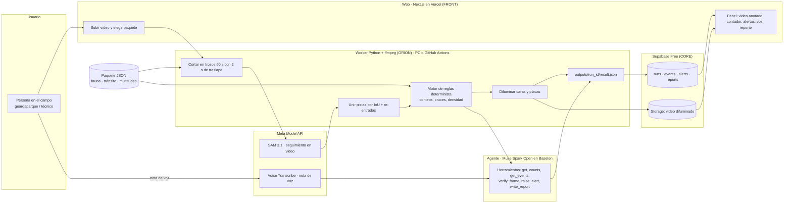

# Rastro · Arquitectura (NOVA, propuesta visual basada en `plan_rastro.md`)

Notas:
- Los números salen del motor de reglas, no del LLM; el agente solo verifica, alerta y redacta.
- El cambio de paquete en el panel lee corridas ya hechas; no recalcula en vivo.
